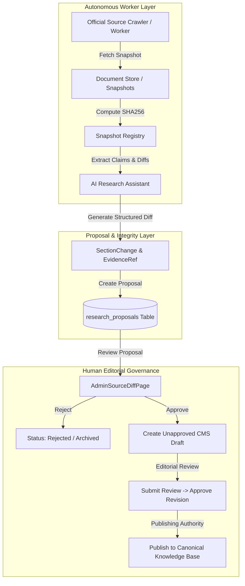

# 01 — RESEARCH ASSISTANT ARCHITECTURE

## 1. System Overview

The Research Assistant in RAD Emigrate is designed as an autonomous, read-heavy, write-isolated intelligence layer. Its primary mandate is to monitor official government gazettes, immigration department portals, and statutory bodies across target jurisdictions (e.g., IRCC in Canada, BAMF/Federal Foreign Office in Germany, Home Affairs in Australia) to detect regulatory changes, fee adjustments, quota updates, and procedural shifts.

The fundamental design principle is **strict isolation of research from publication**. An AI agent or crawler can propose changes based on observed official evidence, but it cannot alter public articles, nor can it bypass the human editorial board.



---

## 2. Evidence Architecture & Provenance Tracking

Every legal finding generated by the research assistant must be anchored in immutable evidence. In RAD Emigrate, this is formalized through `EvidenceRef`:

```dart
class EvidenceRef {
  final String sourceDocumentId; // UUID of the tracked official document
  final String snapshotId;       // UUID of the immutable HTML/PDF snapshot
  final String? claimId;         // Optional UUID of the normalized legal claim
  final String? sectionId;       // Target pathway section UUID
  final String url;              // Canonical government URL
  final String publisher;        // e.g. "Immigration, Refugees and Citizenship Canada"
  final String sourceClass;      // 'official_primary', 'radvisa', 'digivisa', 'radmohajer', 'other'
  final String? authorityId;     // Reference to authorities registry
  final String excerpt;          // Exact textual quote from official source
  final String? locator;         // DOM selector, page number, or section anchor
  final DateTime fetchedAt;      // Ingestion timestamp
  final DateTime? verifiedAt;    // Legal analyst verification timestamp
  final DateTime? freshUntil;    // TTL timestamp based on authority update frequency
  final FactualStatus verificationState; // verified, unverified, conflicting, refuted
  final String freshnessState;   // fresh, stale, unknown
}
```

### Invariants:
1. **Zero Anonymous Claims:** An AI recommendation without an associated `snapshotId` and `sourceDocumentId` fails contract validation and is rejected at the API boundary.
2. **Freshness Invalidation:** When `fresh_until` is exceeded, the evidence transitions automatically from `fresh` to `stale`, triggering a warning chip in the admin console.
3. **SSRF and Domain Restriction:** Only domains registered in `official_authorities` (e.g., `*.gc.ca`, `*.canada.ca`, `*.auswaertiges-amt.de`) can be assigned `official_primary` source classification.

---

## 3. Proposal Lifecycle & Non-Destructive Mutations

When official source updates differ from current canonical pathway content:
1. The research assistant constructs an `AdminSourceChangeProposal`.
2. The proposal calculates an array of `SectionChange` operations:
   - `add`: New statutory clause or requirement introduced.
   - `replace`: Modified eligibility threshold (e.g. proof of funds adjustment).
   - `remove`: Rescinded immigration program or repealed clause.
3. The proposal records `base_revision`, preventing stale proposal application against already-modified articles.
4. Editorial acceptance via `review_research_proposal` creates a new unapproved draft row in `article_revisions` (`editorial_state = 'draft'`).
5. The public reader projection continues serving the last verified published revision without any disruption or unreviewed exposure.
