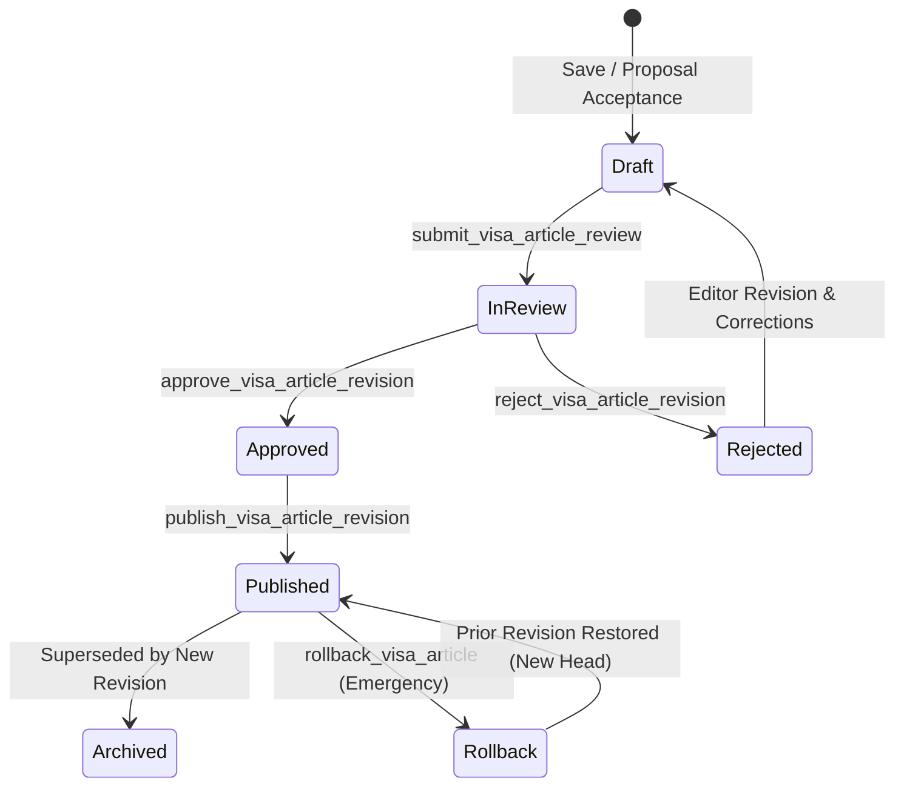

# 02 — CMS LIFECYCLE SPECIFICATION

## 1. Five-Stage Editorial State Machine

RAD Emigrate enforces an explicit, five-stage state machine for all canonical immigration pathway articles and specialized independent topics. Every revision transition requires distinct administrative privileges, cryptographic verification, and concurrency protection.



---

## 2. Transition Rules & API Contracts

### A. Draft Ingestion (`save_visa_article_draft`)
- **Actor:** Content Editor / Admin.
- **Preconditions:** Active authenticated session; valid `article_id`; `expected_revision` matches current draft counter.
- **Effect:** Increments draft counter (`revision = expected_revision + 1`). Leaves `editorial_state = 'draft'`.
- **Public Visibility:** Zero. Strictly excluded from public APIs (`get_visa_article`, `search_visa_articles`).

### B. Review Submission (`submit_visa_article_review`)
- **Actor:** Content Author / Junior Editor.
- **Request Parameters:**
  ```json
  {
    "article_id": "UUID",
    "revision_id": "UUID",
    "expected_revision": 7,
    "content_hash": "SHA256 (64 hex characters)",
    "note": "Initial draft complete; fact-checked against IRCC gazette.",
    "request_key": "UUID (Idempotency key)"
  }
  ```
- **State Transition:** `draft` → `review`.
- **Audit Requirement:** Persists reviewer notes and timestamp.

### C. Editorial Approval (`approve_visa_article_revision`)
- **Actor:** Senior Legal Reviewer / Lead Editor.
- **Request Parameters:** Same envelope as submission, with validation of legal truthfulness.
- **State Transition:** `review` → `approved`.
- **Constraint:** Content cannot be published without passing through `approved` state.

### D. Publication (`publish_visa_article_revision`)
- **Actor:** Authorized Release Manager.
- **Request Parameters:**
  ```json
  {
    "article_id": "UUID",
    "revision_id": "UUID",
    "content_hash": "SHA256",
    "request_key": "UUID"
  }
  ```
- **State Transition:** `approved` → `published`.
- **Side Effects:**
  1. Atomically sets the previous published revision to `archived`.
  2. Updates public search projection tables and alias indices.
  3. Returns `PublicationResult` with navigational dispatch target.

### E. Emergency Rollback (`rollback_visa_article`)
- **Actor:** Super Admin / Release Engineer.
- **Request Parameters:**
  ```json
  {
    "article_id": "UUID",
    "locale": "fa | en",
    "from_revision_id": "UUID",
    "expected_revision": 8,
    "reason": "Regulatory injunction or factual error",
    "request_key": "UUID"
  }
  ```
- **Semantics:** Non-destructive rollback. Rather than deleting database rows, a new revision is appended whose content duplicates `from_revision_id`, advancing the revision sequence number (`revision = expected_revision + 1`) and creating an audit record with `reason`.

---

## 3. Concurrency Protection & Optimistic Locking

All state transitions enforce optimistic concurrency via `expected_revision`:
1. If two editors open revision 7 simultaneously, the first to submit succeeds.
2. The second editor's request arrives with `expected_revision: 7`, but the database row is now at revision 8.
3. The database transaction triggers a PostgreSQL constraint violation (`PT409`), mapped by the repository to `CmsException('conflict')`.
4. The Flutter UI catches this exception and alerts the user:
   *«نسخه مقاله تغییر کرده است؛ قبل از تلاش مجدد نسخه جدید را بررسی کنید.»*
5. Edits are preserved locally in the text fields without data loss.
