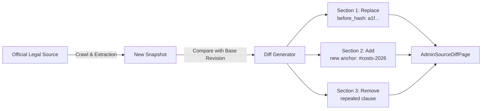

# 03 — SOURCE DIFF ENGINE

## 1. Diff Engine Architecture

The RAD Emigrate Source Diff Engine solves a fundamental flaw common in LLM-assisted knowledge systems: **conflating raw textual diffs with semantic legal alterations**. 

Rather than computing naive word-by-word or Levenshtein character diffs across entire articles, the engine operates at the **Section and ContentBlock** level:
1. Each article section is uniquely addressable via a UUID `section_id` and semantic `anchor` (e.g. `eligibility-criteria`, `required-documents`).
2. Proposed changes are partitioned into discrete, independently auditable operations: `replace`, `add`, `remove`.
3. Each operation is accompanied by the cryptographic `before_hash` of the target section and direct references to official citation claims (`claim_ids`).



---

## 2. Data Contract Specification

The engine relies on three core entities defined in `supabase/contracts/rad_v1.json`:

### A. SectionChange
```json
{
  "section_id": "UUID",
  "operation": "replace | add | remove",
  "before_hash": "SHA256 or null",
  "replacement": { "$ref": "#/$defs/ArticleSectionInput" },
  "claim_ids": ["UUID"]
}
```

### B. ArticleSectionInput & ContentBlock
Sections are composed of typed blocks rather than raw unstructured strings:
- `paragraph`: Standard narrative legal explanation.
- `heading`: Structural subheadings within the section.
- `bullet_list`: Unordered prerequisites, eligible countries, or acceptable credentials.
- `numbered_list`: Step-by-step application procedural sequences.
- `callout`: Warning notices regarding deadlines, quotas, or travel restrictions.

---

## 3. UI/UX Presentation in `AdminSourceDiffPage`

In `lib/features/admin/presentation/pages/admin_source_diff_page.dart`:
1. **Semantic Operation Badging:**
   - `Add`: Rendered with an emerald success badge (`افزودن بخش جدید`).
   - `Replace`: Rendered with a primary blue/amber badge (`جایگزینی محتوا`).
   - `Remove`: Rendered with an error crimson badge (`حذف بخش`).
2. **Anchor & Hash Verification:**
   - Displays the target DOM anchor (e.g. `#eligibility-criteria`) in monospace typography.
   - Truncates and displays the `before_hash` (first 16 hex characters) for tamper detection.
3. **Evidence Panel:**
   - Tapping the "شواهد و مدارک" tab reveals all official citations.
   - Quoted excerpts are styled with Persian typographic quotes («...») and a distinct teal border indicator.
4. **Audit Switcher:**
   - Allows senior reviewers to toggle between the structured visual section diff and the raw underlying JSON contract payload for forensic debugging.
