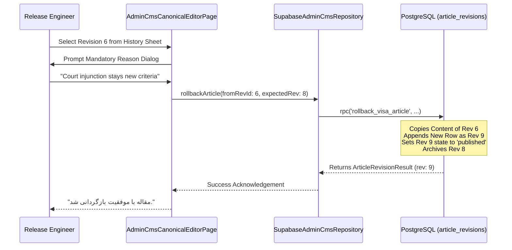

# 08 — ROLLBACK AND DISASTER RECOVERY

## 1. Forward-Rolling Disaster Recovery Protocol

In critical legal systems, conventional database rollbacks (such as issuing `DELETE` or rolling back transactions across published data) introduce severe secondary failure modes: broken client caches, orphaned analytics events, and loss of historical auditability.

RAD Emigrate implements a **Forward-Rolling Recovery Protocol** via `rollback_visa_article`:



---

## 2. Invariants & Guarantees

1. **Immutable History:**
   Neither the flawed revision (e.g. Rev 8) nor any historical revision is ever overwritten or deleted.
2. **Mandatory Audit Justification:**
   Every rollback call requires a non-empty `reason` string:
   ```dart
   if (reason.trim().isEmpty) throw const CmsException('malformed');
   ```
   This reason is permanently attached to the new revision record and accessible via `list_visa_article_revisions`.
3. **Recovery Time Objective (RTO):**
   Sub-second (< 500 ms). Because the rollback is an atomic single-RPC operation in PostgreSQL, the entire public reader view updates instantaneously across all global edge nodes.
4. **Recovery Point Objective (RPO):**
   Zero (0 ms). Any prior verified revision in the system's history can be pinpointed and restored with zero data loss.
