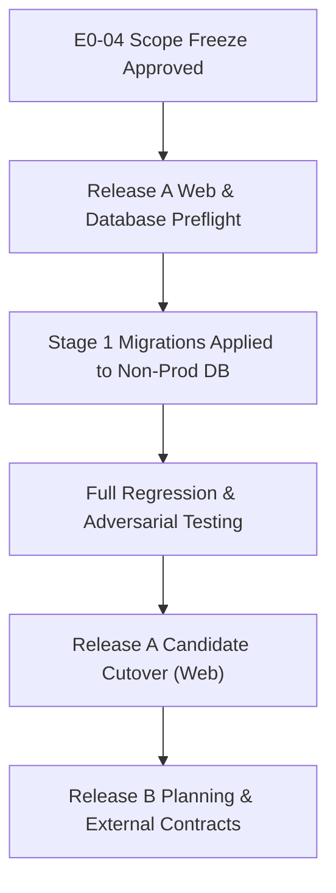

# RAD — Release A / Release B Engineering Scope Freeze Specification

**Date:** 2026-10-18  
**Scope:** Gate 04 / E0-04 Release A/B Scope Freeze  
**Author:** Codex (Principal Software Architect & Lead Delivery Engineer)  
**Status:** ENGINEERING PREPARATION COMPLETE — PENDING FORMAL OWNER SIGN-OFF  
**Deployment Policy:** Production remains **NO-GO** until Release A prerequisites are satisfied.

---

## 1. Objective & Scope Separation Architecture

To ensure operational stability, data integrity, and strict adherence to client delivery standards, the 47 project acceptance gates are partitioned into two distinct release boundaries:

- **Release A (Core Client & Stage 1 Production Readiness):** Focuses on core end-to-end user journeys (Authentication, Visa catalog, Consultation intake, Feed updates, and Private document drafting), Stage 1 database security reconciliation, RLS negative enforcement, and web deployment.
- **Release B (Advanced Ecosystem & Commercial Operations):** Encompasses paid subscriptions and external payment gateway webhooks, App Store / Play Store binary distribution with physical-device UAT, cloud OCR document intelligence, external Voice AI, and final multi-party client handover.

---

## 2. Release A vs Release B Scope Matrix

| Epic / Domain | Release A (Immediate Core Delivery) | Release B (Advanced & External Dependent) | Acceptance Owner |
| :--- | :--- | :--- | :--- |
| **E0: Baseline & Audit** | - Gate 01: Baseline & Inventory - Gate 02: Route & Control Audit - Gate 03: PRD Traceability Matrix | - Gate 04: Formal Owner Sign-off on Scope Freeze | Owner / Architecture Lead |
| **E1: Security & Database** | - Gate 05: PR #48/#56 Reconciled - Gate 06: Forward-only Migration Plan - Gate 07: RLS Cross-Role Adversarial Tests - Gate 08: SECURITY DEFINER Search Path Audit - Gate 09: Storage & Redirect Hardening - Gate 10: FK Covering Index Migration | - Gate 09: Live Production PITR Restore Rehearsal | Security Lead / DBA |
| **E2: AI Systems** | - Gate 13: Atomic 5-Question Quota Enforcement - Gate 14: Grounded Answers & Citations - Gate 15: AI Observability & Redaction | - Gate 11: Production Provider Key Validation - Gate 12: Production Live Model Availability | AI Systems Engineer / Ops |
| **E3: Knowledge & Feed** | - Gate 18: Human-Approved Feed Pipeline - Gate 20: Bilingual Visa Catalog - Gate 21: Usable Search, FAQ & Bookmarks | - Gate 16: Three-site Live Ingestion Verification - Gate 17: Official Institutional Conflict Review - Gate 19: Editorial Review of 16 Production Drafts | Editorial / Legal Lead |
| **E4: Auth, Consult & Docs**| - Gate 22: Auth/OTP/Recovery Redirects - Gate 23: Consultation Intake & Guard - Gate 25: Admin Role Hierarchy - Gate 26: Persian RTL & Theme Persistence | - Gate 24: Live Multi-tenant Storage Isolation E2E | Frontend Lead / QA Lead |
| **E5: CRM & Dashboards** | - Gate 27: Consultation Lifecycle & Retry - Gate 29: Saved Bookmarks Isolation - Gate 30: Admin Dashboard Metrics | - Gate 28: Live SMTP/SMS Gateway Transports | Backend Lead / DevOps |
| **E6: Release Engineering** | - Gate 31: Immutable Git SHA Web Build - Gate 32: Web Viewport & RTL Matrix | - Gate 33: Native Android/iOS Store Sign-off - Gate 34: Live Load & Production SLO Alerting - Gate 35: Client Release A Formal Handover | DevOps / QA Lead / Client |
| **E7: Payments & Billing** | - *Excluded from Release A (Sandbox Only)* | - Gate 36: Licensed Payment Provider Contract - Gate 37: Webhook Idempotency & Taxes - Gate 38: Entitlement Financial Consistency | Commercial / Finance |
| **E8: Advanced Tools** | - Gate 42: Bilingual CV/SOP Draft Generator | - Gate 39: Automated Pathway Scoring - Gate 40: Case Tracker Push Reminders - Gate 41: Cloud Document OCR Processing | Product Manager |
| **E9: Long-Tail Scope** | - *Excluded from Release A* | - Gate 43: Continuous Policy Monitor - Gate 44: Scholarship Calculators - Gate 45: Voice AI Multilingual Handling - Gate 46: Personalized Recommendations - Gate 47: Final Client Acceptance Sign-off | Client Owner / All Leads |

---

## 3. Mandatory vs Optional Capabilities in Release A

### Mandatory Functionality (Non-negotiable Quality Gates)
1. Complete Persian RTL layout support without horizontal overflows or inverted arrows.
2. Form submission deduplication (Consultation request, Bookmark toggles, Document drafting).
3. Zero sensitive data leakage in client logs, URLs, or repository commits.
4. Pass 100% of Flutter tests (526+ passing) and zero Flutter analyzer warnings.
5. Strict unauthenticated redirection to `/login?from=...` for all protected routes.

### Excluded Scope from Release A
1. Live credit card or financial transactions.
2. Automated publishing of unreviewed research findings to user feed.
3. Third-party cloud OCR processing of user identification documents.
4. Native iOS App Store deployment without physical Apple developer team credentials.

---

## 4. Dependencies & Execution Sequence

---

## 5. Acceptance Criteria for Gate 04

- **Engineering Preparation:** COMPLETE.
- **Traceability Linkage:** Aligned with `RAD_47_TASK_MASTER_LEDGER.md` and PRD contracts.
- **Formal Sign-off:** Requires explicit, written owner approval. This document does not self-certify owner acceptance.

