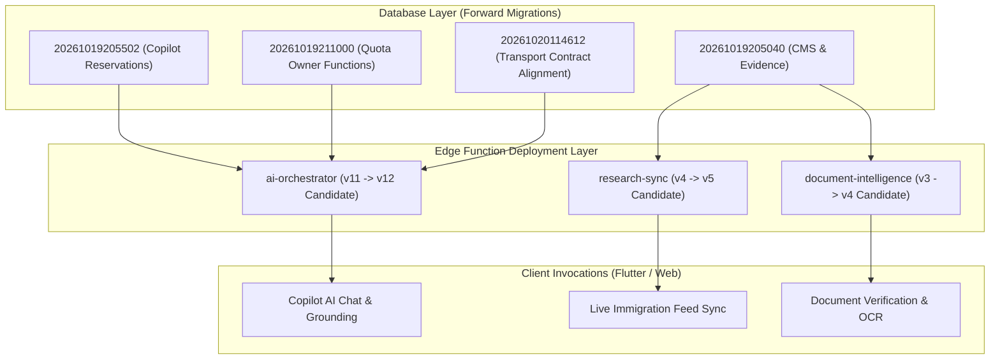

# EDGE FUNCTION DEPENDENCY MATRIX

**Project:** RAD Emigrate (`rademigrate-ai/rad_emigrate`)  
**Stage:** Stage 6 — Supabase Migration Reconciliation & Staging Readiness  
**Target Git SHA:** `671bc2fed782b33c0d198edac4933db4d14a9eb4`  
**PR:** [#74](https://github.com/rademigrate-ai/rad_emigrate/pull/74) (`feat/rad-final-publish-ready-20261021`)  
**Target Project:** `inshddthftkhcdosoqcn`

---

## 1. Executive Summary

RAD Emigrate relies on three production Supabase Edge Functions built on Deno / TypeScript to execute compute-intensive, AI-driven, and asynchronous background tasks.

Analysis of the hosted environment reveals that **all three Edge Functions are deployed in legacy revisions** and require synchronization with the candidate code in PR #74. Because the candidate Edge Functions rely on database RPC signatures and tables introduced in the 21 forward migrations, **strict deployment sequencing (Database Migrations first, then Edge Functions)** is mandatory.



---

## 2. Deployed vs. Candidate Version Forensic Analysis

Forensic inspection of the hosted project (`edge_versions.json` and `deployed_edge_review.json`) versus repository candidate source:

| Function Slug | Hosted Version | Hosted Bundle SHA256 (Prefix) | JWT Verification | Candidate Status | Architectural Drift / Upgrade Needs |
| :--- | :---: | :---: | :---: | :---: | :--- |
| **`ai-orchestrator`** | **11** | `5362558646...` | `true` | **READY (PR #74)** | Upgrades quota reservation to two-phase commit; grounds citations on contract v1 knowledge base; supports `x-rad-request-key` idempotency. |
| **`research-sync`** | **4** | `88d4953458...` | `false` (Cron/Webhook) | **READY (PR #74)** | Integrates official source hash verification; handles leased worker state; supports multi-destination sync. |
| **`document-intelligence`** | **3** | `ebc7450c0b...` | `true` | **READY (PR #74)** | Enforces strict document ownership isolation; implements retry backoff on storage fetch; checks MIME integrity. |

---

## 3. Function-by-Function Dependency Mapping

### 3.1 `ai-orchestrator`
- **Primary Mission**: Serves the conversational AI migration assistant, calculates daily user token quotas, executes guest rate limiting, and grounds responses on verified official immigration evidence.
- **Required Database Migrations**:
  - `20261019205502_rad_copilot_scoped_reservations.sql` (Creates `ai_requests` reservation ledger).
  - `20261019211000_security_quota_owner_and_publish_approved.sql` (Exposes `consume_ai_daily_quota` and `consume_ai_guest_quota` RPCs).
  - `20261019214411_rad_legacy_quota_budget_compatibility.sql` (Handles backwards compatibility for legacy quotas).
  - `20261020114612_rad_transport_contract_registry_alignment.sql` (Aligns REST schema mapping).
- **Required Database RPCs**:
  - `public.consume_ai_daily_quota(p_user_id uuid, p_role text, p_tokens integer, p_request_key text)`
  - `public.consume_ai_guest_quota(p_guest_key_hash text, p_tokens integer, p_request_key text)`
  - `public.settle_ai_quota_reservation(p_reservation_id uuid, p_actual_tokens integer)`
  - `public.get_ai_access_decision(p_user_id uuid, p_guest_key_hash text)`
- **Required Secrets & Environment Variables**:
  - `OPENAI_API_KEY`: Primary LLM backend for complex evaluations.
  - `DEEPSEEK_API_KEY`: High-throughput LLM backend for search query parsing.
  - `SUPABASE_URL`: Project gateway endpoint.
  - `SUPABASE_SERVICE_ROLE_KEY`: Secure database client for atomic quota settlement.
  - `SUPABASE_ANON_KEY`: Client token validation.
- **CORS Requirements**:
  - Headers: `authorization, x-client-info, apikey, content-type, x-rad-request-key, x-rad-modality`.
  - Allowed Methods: `POST, OPTIONS`.

### 3.2 `research-sync`
- **Primary Mission**: Periodically crawls, validates, and ingests official immigration source updates from government portals (IRCC, USCIS, Home Affairs), creating verifiable knowledge snapshots.
- **Required Database Migrations**:
  - `20261019205040_rad_visa_cms_official_evidence.sql` (Creates `official_sources` and `research_snapshots` tables).
  - `20261019212615_rad_source_jobs_merge_enforcement.sql` (Enforces merge lock and hash deduplication).
  - `20261020115539_rad_leased_research_base_contract.sql` (Defines worker leasing lease duration).
- **Required Database RPCs**:
  - `public.claim_research_source_lease(p_worker_id text, p_lease_seconds integer)`
  - `public.record_research_snapshot(p_source_id uuid, p_content_hash text, p_content text, p_metadata jsonb)`
  - `public.release_research_source_lease(p_source_id uuid, p_worker_id text)`
- **Required Secrets & Environment Variables**:
  - `SUPABASE_URL`: Target Supabase instance URL.
  - `SUPABASE_SERVICE_ROLE_KEY`: Service privileges required to bypass public RLS when storing official snapshots.
  - `RESEARCH_CRON_SECRET`: Bearer authentication token for cron invocation.
- **CORS Requirements**: Not callable from client browsers (Server-to-Server invocation).

### 3.3 `document-intelligence`
- **Primary Mission**: Inspects uploaded visa documentation (passports, bank statements, language test certificates) stored in Supabase Storage, extracts text, and evaluates completeness.
- **Required Database Migrations**:
  - `20261001195756_storage_policies.sql` (Defines storage bucket access).
  - `20261001200202_ai_sessions_and_document_bootstrap.sql` (Defines `documents` table).
- **Required Storage Buckets**:
  - `documents` (Private bucket with authenticated owner RLS).
- **Required Database RPCs**:
  - `public.update_document_processing_status(p_document_id uuid, p_status text, p_extracted_data jsonb)`
- **Required Secrets & Environment Variables**:
  - `SUPABASE_URL`: Storage object fetch URL.
  - `SUPABASE_SERVICE_ROLE_KEY`: Authenticated service role for secure object read.
  - `VISION_OCR_API_KEY`: API key for document OCR processing engine.
- **CORS Requirements**:
  - Headers: `authorization, x-client-info, apikey, content-type`.
  - Allowed Methods: `POST, OPTIONS`.

---

## 4. Preflight Configuration & Secrets Verification Checklist

Before deploying candidate Edge Functions to Staging or Production, the following environment variables must be verified in the target Supabase project:

| Secret Name | Present on Hosted | Format / Check | Criticality |
| :--- | :---: | :--- | :--- |
| `SUPABASE_URL` | YES | `https://inshddthftkhcdosoqcn.supabase.co` | **BLOCKING** |
| `SUPABASE_SERVICE_ROLE_KEY` | YES | Standard JWT (`eyJhbGciOiJI...`) | **BLOCKING** |
| `SUPABASE_ANON_KEY` | YES | Standard JWT (`eyJhbGciOiJI...`) | **BLOCKING** |
| `OPENAI_API_KEY` | YES (Verify) | `sk-proj-...` | **BLOCKING** |
| `DEEPSEEK_API_KEY` | REQUIRED | `sk-...` | **HIGH** |
| `RESEARCH_CRON_SECRET` | REQUIRED | Random UUID or 32+ char hex | **MEDIUM** |
| `VISION_OCR_API_KEY` | REQUIRED | Vendor API Key | **MEDIUM** |

---

## 5. Deployment Sequencing Runbook

Because Edge Functions contain code expecting newly added database columns and RPC procedures, deploying in the wrong order will cause fatal HTTP 500 runtime errors.

### Safe Rollout Sequence:
1. **Phase 1: Database Migration Reconciliation**
   - Apply the 21 forward migrations in order (`20261019204906` through `20261021210337`).
   - Run database schema verification to ensure new RPCs exist.
2. **Phase 2: Configuration & Secrets Verification**
   - Confirm all required secrets exist via Supabase CLI:
     ```bash
     supabase secrets list --project-ref inshddthftkhcdosoqcn
     ```
3. **Phase 3: Deploy `research-sync`**
   - Non-user facing; safe to deploy and test first:
     ```bash
     supabase functions deploy research-sync --project-ref inshddthftkhcdosoqcn --no-verify-jwt
     ```
4. **Phase 4: Deploy `document-intelligence`**
   - User-authenticated background worker:
     ```bash
     supabase functions deploy document-intelligence --project-ref inshddthftkhcdosoqcn
     ```
5. **Phase 5: Deploy `ai-orchestrator`**
   - Core interactive customer conversational engine:
     ```bash
     supabase functions deploy ai-orchestrator --project-ref inshddthftkhcdosoqcn
     ```
6. **Phase 6: Live Smoke Verification**
   - Execute synthetic health check on `ai-orchestrator`:
     ```bash
     curl -i -X OPTIONS https://inshddthftkhcdosoqcn.supabase.co/functions/v1/ai-orchestrator
     ```
   - Verify `Access-Control-Allow-Headers` includes `x-rad-request-key` and `x-rad-modality`.

---

## 6. Rollback Procedures

If an Edge Function fails post-deployment, the rollback is rapid and does not require rolling back the database migrations (since the forward database schema is strictly backward-compatible):

1. **Rollback via Supabase CLI**:
   Redeploy the previous stable version artifact:
   ```bash
   # In emergency rollback:
   supabase functions deploy ai-orchestrator --project-ref inshddthftkhcdosoqcn --legacy-bundle
   ```
2. **Rollback Bundle Hashes**:
   The previous confirmed hosted bundle SHA256 hashes are recorded for immediate restoration:
   - `ai-orchestrator` v11: `5362558646da14d5f50c9a381b1299964363b4bad67023eb07ab626f619ee007`
   - `research-sync` v4: `88d4953458ecc7c9f010270dc234d8ea1a2352ffc6728f9251fcb5d806bce476`
   - `document-intelligence` v3: `ebc7450c0bb96a36021dd5fb2e267d810caf39c6dd1dbfc1f3acd830b28ad064`
