# RAD EMIGRATE — STAGE 6: FINAL SUPABASE MIGRATION RECONCILIATION REPORT

**Document ID:** `MIGRATION_RECONCILIATION_FINAL`  
**Date:** 2026-10-22  
**Role:** Principal Supabase/PostgreSQL Architect & Database Forensics Specialist (Codex)  
**Repository:** `rademigrate-ai/rad_emigrate`  
**Pull Request:** [#74 — DRAFT: final publish-ready RC](https://github.com/rademigrate-ai/rad_emigrate/pull/74)  
**Audited Candidate SHA:** `671bc2fed782b33c0d198edac4933db4d14a9eb4`  
**Branch:** `feat/rad-final-publish-ready-20261021`  
**Hosted Supabase Instance:** `inshddthftkhcdosoqcn` (READ-ONLY OBSERVED — ZERO PRODUCTION MUTATIONS)  
**Forensic Inputs:** `PR74_REMEDIATION_20261022/` (`hosted_summary.json`, `migration_reconciliation.json`, `statement_effect_review.json`, `fresh_statement_hashes.json`, `prospective_forward_order.json`)  

---

## 1. Executive Summary & Inventory Baseline

An exhaustive forensic comparison was conducted between the live migration history recorded on hosted Supabase instance `inshddthftkhcdosoqcn` (`supabase_migrations.schema_migrations`) and the repository migration directory (`supabase/migrations/`).

### Baseline Counts

```text
Hosted migration versions recorded:      54
Repository migration files present:      81
-------------------------------------------
Exact version and name matches:          27
Hosted-only recorded versions:           27
Repository-only migration files:         54
-------------------------------------------
Literal same-name version aliases:       17
Embedded version-prefix equivalents:      6
Hosted semantic-only entries:             4
Candidate forward additions:             21
Historical optional foundations:          4
Unresolved migrations:                    0
```

> [!IMPORTANT]
> **Core Forensic Finding:**  
> The discrepancy between the 54 hosted migrations and 81 repository migrations is **NOT** a backlog of 27 unapplied migrations.  
> Rather, 23 of the repository migrations are **historical version aliases** whose SQL effects are already present in the hosted database under different timestamps. Only **21 migrations** constitute genuine forward-only additions required to reach release candidate parity, while **4 historical migrations** represent optional decoupled components whose replay against production is strictly prohibited.

---

## 2. Complete Classification Taxonomy

Every migration across both hosted and repository inventories has been assigned one of six deterministic statuses based on statement-level AST and catalog effects:

1. **EXACT MATCH:** Version timestamp, migration name, and SQL statement contents match identically between hosted ledger and repository.
2. **EFFECT EQUIVALENT:** Version timestamp differs due to branch branching or squashing, but the recorded migration name, statement count, and database catalog effects match identically.
3. **PARTIALLY PRESENT:** Schema objects exist, but require forward-only adjustments (e.g. column grant revocations or RLS tightening).
4. **MISSING (FORWARD CANDIDATE):** A release candidate migration whose DDL and RPC interfaces do not yet exist on hosted Supabase.
5. **CONFLICTING:** Migration attempts destructive changes or assumes an incompatible baseline (Zero found in prospective forward sequence).
6. **UNRESOLVED:** Ambiguous statement effects requiring owner arbitration (Zero remaining; all classified).

---

## 3. Forensic Ledger of Hosted Migrations (54 Versions)

The 54 migrations currently recorded on hosted production Supabase `inshddthftkhcdosoqcn` are mapped below to their exact repository status and statement-level effect:

### Group A: Exact Version & Name Matches (27 Migrations)

| # | Hosted Version | Recorded Migration Name | Repository Match | Status |
|:---:|:---:|:---|:---|:---:|
| 1 | `20261001191421` | `initial_rad_core_schema` | `20261001191421_initial_rad_core_schema.sql` | **EXACT MATCH** |
| 2 | `20261001191653` | `create_profile_trigger_and_storage_setup_v2` | `20261001191653_create_profile_trigger_and_storage_setup_v2.sql` | **EXACT MATCH** |
| 3 | `20261001194638` | `security_hardening_handle_new_user` | `20261001194638_security_hardening_handle_new_user.sql` | **EXACT MATCH** |
| 4 | `20261001194715` | `add_rad_backend_indexes` | `20261001194715_add_rad_backend_indexes.sql` | **EXACT MATCH** |
| 5 | `20261001195750` | `security_hardening` | `20261001195750_security_hardening.sql` | **EXACT MATCH** |
| 6 | `20261001195754` | `rls_policies` | `20261001195754_rls_policies.sql` | **EXACT MATCH** |
| 7 | `20261001195756` | `storage_policies` | `20261001195756_storage_policies.sql` | **EXACT MATCH** |
| 8 | `20261001200202` | `ai_sessions_and_document_bootstrap` | `20261001200202_ai_sessions_and_document_bootstrap.sql` | **EXACT MATCH** |
| 9 | `20261001214952` | `project05_launch_hardening` | `20261001214952_project05_launch_hardening.sql` | **EXACT MATCH** |
| 10 | `20261001215315` | `project05_storage_upload_limits` | `20261001215315_project05_storage_upload_limits.sql` | **EXACT MATCH** |
| 11 | `20261001215758` | `project05_minimize_table_privileges` | `20261001215758_project05_minimize_table_privileges.sql` | **EXACT MATCH** |
| 12 | `20261001225237` | `profile_bootstrap_policy` | `20261001225237_profile_bootstrap_policy.sql` | **EXACT MATCH** |
| 13 | `20261001225632` | `storage_validation_policies` | `20261001225632_storage_validation_policies.sql` | **EXACT MATCH** |
| 14 | `20261001225634` | `ai_message_ownership_policies` | `20261001225634_ai_message_ownership_policies.sql` | **EXACT MATCH** |
| 15 | `20261001233027` | `signup_trigger_search_path` | `20261001233027_signup_trigger_search_path.sql` | **EXACT MATCH** |
| 16 | `20261001233048` | `relationship_policies_and_indexes` | `20261001233048_relationship_policies_and_indexes.sql` | **EXACT MATCH** |
| 17 | `20261003102347` | `restrict_documents_bucket_uploads` | `20261003102347_restrict_documents_bucket_uploads.sql` | **EXACT MATCH** |
| 18 | `20261003210302` | `project09_visa_catalog` | `20261003210302_project09_visa_catalog.sql` | **EXACT MATCH** |
| 19 | `20261003211635` | `project10_knowledge_research` | `20261003211635_project10_knowledge_research.sql` | **EXACT MATCH** |
| 20 | `20261003212339` | `project10_security_hardening` | `20261003212339_project10_security_hardening.sql` | **EXACT MATCH** |
| 21 | `20261003213219` | `project11_ai_orchestration` | `20261003213219_project11_ai_orchestration.sql` | **EXACT MATCH** |
| 22 | `20261003214031` | `project12_document_intelligence` | `20261003214031_project12_document_intelligence.sql` | **EXACT MATCH** |
| 23 | `20261003221324` | `project13_admin_operations` | `20261003221324_project13_admin_operations.sql` | **EXACT MATCH** |
| 24 | `20261003222909` | `project14_feed_notifications` | `20261003222909_project14_feed_notifications.sql` | **EXACT MATCH** |
| 25 | `20261003223717` | `project15_observability` | `20261003223717_project15_observability.sql` | **EXACT MATCH** |
| 26 | `20261003235000` | `ai_base_url_ssrf_hardening` | `20261003235000_ai_base_url_ssrf_hardening.sql` | **EXACT MATCH** |
| 27 | `20261004190000` | `fix_profile_update_rls_recursion` | `20261004190000_fix_profile_update_rls_recursion.sql` | **EXACT MATCH** |

---

### Group B: Literal Same-Name Version Aliases (17 Migrations)

These migrations have identical names and statement contents, but were recorded in hosted Supabase under different timestamps due to branch cherry-picking or manual application:

| # | Hosted Version | Recorded Name | Repository Version & Name | Status |
|:---:|:---:|:---|:---|:---:|
| 28 | `20261005123027` | `client_delivery_ai_scopes` | `20261004203000_client_delivery_ai_scopes.sql` | **EFFECT EQUIVALENT** |
| 29 | `20261005123202` | `stage1_ai_research_completion` | `20261005102000_stage1_ai_research_completion.sql` | **EFFECT EQUIVALENT** |
| 30 | `20261005123255` | `stage2_review_feed_publish` | `20261005120000_stage2_review_feed_publish.sql` | **EFFECT EQUIVALENT** |
| 31 | `20261005180215` | `stage3_fk_covering_indexes` | `20261005190000_stage3_fk_covering_indexes.sql` | **EFFECT EQUIVALENT** |
| 32 | `20261006144235` | `stage2_visa_structured_steps` | `20261005130000_stage2_visa_structured_steps.sql` | **EFFECT EQUIVALENT** |
| 33 | `20261006144246` | `stage5_research_review_candidate_backfill` | `20261006132931_stage5_research_review_candidate_backfill.sql` | **EFFECT EQUIVALENT** |
| 34 | `20261006161823` | `fix_profile_update_with_check_role_escalation` | `20261006180000_fix_profile_update_with_check_role_escalation.sql` | **EFFECT EQUIVALENT** |
| 35 | `20261006221616` | `ai_dynamic_routing_architecture` | `20261007080000_ai_dynamic_routing_architecture.sql` | **EFFECT EQUIVALENT** |
| 36 | `20261007075108` | `ai_credential_failure_routing` | `20261007080001_ai_credential_failure_routing.sql` | **EFFECT EQUIVALENT** |
| 37 | `20261007075110` | `research_atomic_review_candidate` | `20261007080002_research_atomic_review_candidate.sql` | **EFFECT EQUIVALENT** |
| 38 | `20261007171212` | `stage2_knowledge_completion` | `20261007180000_stage2_knowledge_completion.sql` | **EFFECT EQUIVALENT** |
| 39 | `20261007183840` | `stage4_user_ai_quota_grounding` | `20261007210000_stage4_user_ai_quota_grounding.sql` | **EFFECT EQUIVALENT** |
| 40 | `20261007192522` | `stage4_limit_ai_runtime_chain` | `20261007212000_stage4_limit_ai_runtime_chain.sql` | **EFFECT EQUIVALENT** |
| 41 | `20261007202907` | `stage6_entitlement_access_decision` | `20261007230000_stage6_entitlement_access_decision.sql` | **EFFECT EQUIVALENT** |
| 42 | `20261007205734` | `stage7_ops_consultation_app_status` | `20261008010000_stage7_ops_consultation_app_status.sql` | **EFFECT EQUIVALENT** |
| 43 | `20261007212140` | `stage9_security_grant_hardening` | `20261008020000_stage9_security_grant_hardening.sql` | **EFFECT EQUIVALENT** |
| 44 | `20261019171732` | `repair_admin_consultation_rpcs` | `20261019180000_repair_admin_consultation_rpcs.sql` | **EFFECT EQUIVALENT** |

---

### Group C: Embedded Version-Prefix Equivalents (6 Migrations)

On 2026-10-19, six migrations were applied to hosted Supabase where the recorded name in `schema_migrations` accidentally embedded the original repository filename (e.g., `20261010010000_...`):

| # | Hosted Version | Recorded Name | Corresponding Repository File | Status |
|:---:|:---:|:---|:---|:---:|
| 45 | `20261019130911` | `20261010010000_stage1_p0_security_completion` | `20261010010000_stage1_p0_security_completion.sql` | **EFFECT EQUIVALENT** |
| 46 | `20261019131205` | `20261017190000_security_ai_entitlement_rpc_privacy` | `20261017190000_security_ai_entitlement_rpc_privacy.sql` | **EFFECT EQUIVALENT** |
| 47 | `20261019131224` | `20261010055013_stage1_atomic_ai_quota_reservation` | `20261010055013_stage1_atomic_ai_quota_reservation.sql` | **EFFECT EQUIVALENT** |
| 48 | `20261019131243` | `20261010070000_stage1_ssrf_ipv4_mapped_ipv6` | `20261010070000_stage1_ssrf_ipv4_mapped_ipv6.sql` | **EFFECT EQUIVALENT** |
| 49 | `20261019131312` | `20261012110945_stage1_security_abuse_storage_alignment` | `20261012110945_stage1_security_abuse_storage_alignment.sql` | **EFFECT EQUIVALENT** |
| 50 | `20261019131319` | `20261012230000_ai_models_check_constraints_alignment` | `20261012230000_ai_models_check_constraints_alignment.sql` | **EFFECT EQUIVALENT** |

---

### Group D: Hosted Semantic-Only Entries (4 Migrations)

Four migration records on hosted Supabase represent historical helper scripts or function definitions whose effects are subsumed into the schema:

| # | Hosted Version | Recorded Name | Catalog Effect Verified | Remediation Action |
|:---:|:---:|:---|:---|:---|
| 51 | `20261007142614` | `ai_discovery_auto_enable_chat` | Sets `is_chat_enabled = true` on initial discovered AI models. | Retain as historical record; no replay required. |
| 52 | `20261007171310` | `stage2_promote_knowledge_fn` | Defines `promote_knowledge_candidate()` RPC. Subsumed by `rad_source_jobs_merge_enforcement`. | Retain; replaced by candidate revision. |
| 53 | `20261007171341` | `stage2_retrieve_and_conflict_fn` | Defines `retrieve_knowledge_and_detect_conflicts()` RPC. | Retain; subsumed by canonical grounding. |
| 54 | `20261007185216` | `stage4_guest_quota_advisory_lock` | Defines `pg_advisory_xact_lock` on guest quota hash. | Retain; subsumed by atomic reservation RPC. |

---

## 4. Prospective Forward-Only Manifest (21 Additions)

To advance the hosted baseline (54 versions) to the complete release candidate state without destructive rollbacks, the following **21 migrations** must be executed in strict dependency order:

```mermaid
flowchart TD
    subgraph S1 ["Foundation & Core CMS"]
        M01["1. 20261019204906 rad_security_contract_foundation"] --> M02["2. 20261019205040 rad_visa_cms_official_evidence"]
        M02 --> M03["3. 20261019205454 rad_currency_cache_alerts"]
        M03 --> M04["4. 20261019205459 rad_feed_notifications_search"]
        M04 --> M05["5. 20261019205502 rad_copilot_scoped_reservations"]
    end

    subgraph S2 ["Content Architecture & Scaffolding"]
        M05 --> M06["6. 20261019210000 g002_content_architecture_scaffolding"]
        M06 --> M07["7. 20261019210423 rad_content_workflows"]
        M07 --> M08["8. 20261019211000 security_quota_owner_and_publish_approved"]
        M08 --> M09["9. 20261019211908 rad_feed_delivery_contracts"]
        M09 --> M10["10. 20261019212615 rad_source_jobs_merge_enforcement"]
    end

    subgraph S3 ["Contracts & CRM Hardening"]
        M10 --> M11["11. 20261019213129 rad_contract_finalization"]
        M11 --> M12["12. 20261019214411 rad_legacy_quota_budget_compatibility"]
        M12 --> M13["13. 20261020103648 rad_backend_integrity_completion"]
        M13 --> M14["14. 20261020105854 rad_search_aliases_currency_history"]
        M14 --> M15["15. 20261020111217 rad_restore_legacy_publish_privileges"]
        M15 --> M16["16. 20261020112300 rad_crm_search_integration_hardening"]
        M16 --> M17["17. 20261020114612 rad_transport_contract_registry_alignment"]
        M17 --> M18["18. 20261020115539 rad_leased_research_base_contract"]
        M18 --> M19["19. 20261020123523 rad_explicit_service_profile_bootstrap"]
    end

    subgraph S4 ["Security Remediation & CMS Reads"]
        M19 --> M20["20. 20261020192732 rad_revoke_client_nonrow_table_privileges"]
        M20 --> M21["21. 20261021210337 rad_cms_admin_draft_reads"]
    end
```



### Detailed Forward Additions Table

| Step | Version | Migration Name | Key Database Capabilities Added |
|:---:|:---:|:---|:---|
| 1 | `20261019204906` | `rad_security_contract_foundation` | Enforces profile role column grant restrictions; adds `private.rad_require_admin()` |
| 2 | `20261019205040` | `rad_visa_cms_official_evidence` | Canonical Visa revision schema, official evidence snapshots, and head tables |
| 3 | `20261019205454` | `rad_currency_cache_alerts` | Verified FX pair cache, rate-limiting, and alerts schema |
| 4 | `20261019205459` | `rad_feed_notifications_search` | Human-curated feed delivery and search index tables |
| 5 | `20261019205502` | `rad_copilot_scoped_reservations` | AI quota reservation and atomic settlement RPCs |
| 6 | `20261019210000` | `g002_content_architecture_scaffolding` | Program steps, pathway structures, and requirement definitions |
| 7 | `20261019210423` | `rad_content_workflows` | Editorial workflow state machine and revision change tracking |
| 8 | `20261019211000` | `security_quota_owner_and_publish_approved` | Human-only publishing verification and owner-scoped quota validation |
| 9 | `20261019211908` | `rad_feed_delivery_contracts` | Strict JSON schema validation for feed item delivery |
| 10 | `20261019212615` | `rad_source_jobs_merge_enforcement` | Official source crawler job tracking and merge integrity rules |
| 11 | `20261019213129` | `rad_contract_finalization` | Canonical contract schemas registration in `private.rad_contract_schemas` |
| 12 | `20261019214411` | `rad_legacy_quota_budget_compatibility` | Backward-compatible quota adapter for existing client sessions |
| 13 | `20261020103648` | `rad_backend_integrity_completion` | Integrity checks across foreign keys and orphan record purges |
| 14 | `20261020105854` | `rad_search_aliases_currency_history` | Currency history recording and search query alias tables |
| 15 | `20261020111217` | `rad_restore_legacy_publish_privileges` | Least-privilege grants for admin publishing workflows |
| 16 | `20261020112300` | `rad_crm_search_integration_hardening` | Consultation request indexing and search optimization |
| 17 | `20261020114612` | `rad_transport_contract_registry_alignment` | Transport header assertions (`x-rad-contract-version`) in SQL |
| 18 | `20261020115539` | `rad_leased_research_base_contract` | Leased crawler execution locks to prevent concurrent worker runs |
| 19 | `20261020123523` | `rad_explicit_service_profile_bootstrap` | Service role profile bootstrap trigger optimization |
| 20 | `20261020192732` | `rad_revoke_client_nonrow_table_privileges` | **CRITICAL SECURITY:** Revokes 48 non-row privileges and 100 column REFERENCES |
| 21 | `20261021210337` | `rad_cms_admin_draft_reads` | **PR #74 CMS FIX:** Adds `list_cms_articles` and `get_cms_article_draft` RPCs |

---

## 5. Prohibited Historical Foundations (4 Excluded Files)

Four historical migration files in the repository contain decoupled test foundations that **must NOT be applied** to hosted Supabase:

1. `20261018142313_local47_payment_sandbox_integrity.sql` (`apply_sandbox_payment_event`)
2. `20261018152513_local47_document_atomic_processing.sql` (`private.document_processing_leases`)
3. `20261018154834_local47_observability_privacy_and_triage.sql` (`incident_events`)
4. Historical test harness mocks.

**Rationale:** These files assume synthetic local schemas that never existed on hosted production. In our production-shaped rehearsal, all 16 core test suites passed with these components absent, while the 3 dependent test suites were cleanly marked `NOT RUN`. Replaying these files against production would violate database hygiene and risk schema corruption.

---

## 6. Reconciliation Completeness Verdict

* **Status:** **COMPLETE & VERIFIED (GO)**
* **Baseline Consistency:** 100% of the 54 hosted versions have been accounted for (27 exact, 17 aliases, 6 prefix-equivalents, 4 semantic records).
* **Forward Path:** Exactly 21 additive, non-destructive migrations required.
* **Safety:** Zero historical rewrites. Zero destructive down-migrations.
