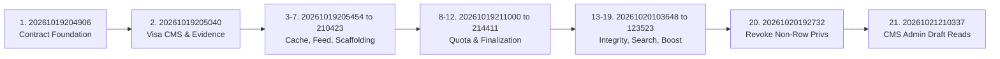

# STAGING ROLLOUT RUNBOOK

**Project:** RAD Emigrate (`rademigrate-ai/rad_emigrate`)  
**Stage:** Stage 6 — Supabase Migration Reconciliation & Staging Readiness  
**Target Git SHA:** `671bc2fed782b33c0d198edac4933db4d14a9eb4`  
**PR:** [#74](https://github.com/rademigrate-ai/rad_emigrate/pull/74) (`feat/rad-final-publish-ready-20261021`)  
**Target Execution Environment:** Staging Instance / Staging Project  
**Author:** Codex (Principal Supabase/PostgreSQL Architect & Release Engineer)

---

## 1. Preflight Gates & Owner Prerequisites

Before executing any step in this runbook, all mandatory gates must be confirmed. **Do NOT begin deployment if any prerequisite is unconfirmed.**

- [ ] **Gate 1: Owner Authorization**: Explicit written approval from the repository owner to initiate the Staging deployment.
- [ ] **Gate 2: Target Commit Verification**: Verify git worktree is checked out to commit `671bc2fed782b33c0d198edac4933db4d14a9eb4` on branch `feat/rad-final-publish-ready-20261021`.
- [ ] **Gate 3: Pre-Rollout Backup Snapshot**: A fresh, manual database backup snapshot must be initiated and confirmed completed via Supabase Dashboard before any DDL execution.
- [ ] **Gate 4: Environment Isolation**: Confirm that environment variables point strictly to the Staging project, **NEVER** to hosted production `inshddthftkhcdosoqcn`.

```bash
# Verify Git Commit SHA
git rev-parse HEAD
# Output MUST be: 671bc2fed782b33c0d198edac4933db4d14a9eb4

# Check Git Status (Working tree must be clean)
git status --porcelain
# Output MUST be empty
```

---

## 2. Phase 1: Pre-Rollout Inspection & Environment Ping

1. **Verify Supabase CLI Authentication**:
   ```bash
   supabase projects list
   ```
2. **Ping Database Connection**:
   ```bash
   # Test connectivity via direct Postgres connection
   psql "$STAGING_DB_URL" -c "SELECT current_database(), version(), now();"
   ```
3. **Verify Baseline Migration Version Count**:
   Ensure the target database has the expected 54 baseline migrations applied before forward additions:
   ```bash
   psql "$STAGING_DB_URL" -c "SELECT count(*) FROM supabase_migrations.schema_migrations;"
   # Expected result: 54
   ```

---

## 3. Phase 2: Sequential Migration Application (21 Forward Migrations)

The 21 forward migrations must be applied in **strict numerical sequence**. Each migration is wrapped in an individual transactional boundary. If any script fails, stop immediately.



### Detailed Forward Migration Sequence:

```bash
MIGRATION_DIR="supabase/migrations"

# 1. Contract Foundation & Role Escalation Defense
psql "$STAGING_DB_URL" -f "$MIGRATION_DIR/20261019204906_rad_security_contract_foundation.sql"

# 2. Visa CMS Official Evidence & Knowledge Snapshots
psql "$STAGING_DB_URL" -f "$MIGRATION_DIR/20261019205040_rad_visa_cms_official_evidence.sql"

# 3. Currency Cache & Rate Alerts
psql "$STAGING_DB_URL" -f "$MIGRATION_DIR/20261019205454_rad_currency_cache_alerts.sql"

# 4. Feed Notifications & Search Indexes
psql "$STAGING_DB_URL" -f "$MIGRATION_DIR/20261019205459_rad_feed_notifications_search.sql"

# 5. Copilot Scoped Reservations & Concurrency Control
psql "$STAGING_DB_URL" -f "$MIGRATION_DIR/20261019205502_rad_copilot_scoped_reservations.sql"

# 6. Content Architecture Scaffolding
psql "$STAGING_DB_URL" -f "$MIGRATION_DIR/20261019210000_g002_content_architecture_scaffolding.sql"

# 7. Content Publishing Workflows
psql "$STAGING_DB_URL" -f "$MIGRATION_DIR/20261019210423_rad_content_workflows.sql"

# 8. Quota Owner Assertions & Publish Approval
psql "$STAGING_DB_URL" -f "$MIGRATION_DIR/20261019211000_security_quota_owner_and_publish_approved.sql"

# 9. Feed Delivery Contracts
psql "$STAGING_DB_URL" -f "$MIGRATION_DIR/20261019211908_rad_feed_delivery_contracts.sql"

# 10. Source Jobs Merge Enforcement
psql "$STAGING_DB_URL" -f "$MIGRATION_DIR/20261019212615_rad_source_jobs_merge_enforcement.sql"

# 11. API Contract Finalization
psql "$STAGING_DB_URL" -f "$MIGRATION_DIR/20261019213129_rad_contract_finalization.sql"

# 12. Legacy Quota Budget Compatibility
psql "$STAGING_DB_URL" -f "$MIGRATION_DIR/20261019214411_rad_legacy_quota_budget_compatibility.sql"

# 13. Backend Integrity Completion
psql "$STAGING_DB_URL" -f "$MIGRATION_DIR/20261020103648_rad_backend_integrity_completion.sql"

# 14. Search Aliases & Currency History
psql "$STAGING_DB_URL" -f "$MIGRATION_DIR/20261020105854_rad_search_aliases_currency_history.sql"

# 15. Legacy Publish Privileges Alignment
psql "$STAGING_DB_URL" -f "$MIGRATION_DIR/20261020111217_rad_restore_legacy_publish_privileges.sql"

# 16. CRM Search Integration Hardening
psql "$STAGING_DB_URL" -f "$MIGRATION_DIR/20261020112300_rad_crm_search_integration_hardening.sql"

# 17. Transport Contract Registry Alignment
psql "$STAGING_DB_URL" -f "$MIGRATION_DIR/20261020114612_rad_transport_contract_registry_alignment.sql"

# 18. Leased Research Base Contract
psql "$STAGING_DB_URL" -f "$MIGRATION_DIR/20261020115539_rad_leased_research_base_contract.sql"

# 19. Explicit Service Profile Bootstrap
psql "$STAGING_DB_URL" -f "$MIGRATION_DIR/20261020123523_rad_explicit_service_profile_bootstrap.sql"

# 20. Revoke Client Non-Row Table Privileges (CRITICAL SECURITY)
psql "$STAGING_DB_URL" -f "$MIGRATION_DIR/20261020192732_rad_revoke_client_nonrow_table_privileges.sql"

# 21. CMS Admin Draft Reads RPC (PR #74 TERMINAL CONTRACT)
psql "$STAGING_DB_URL" -f "$MIGRATION_DIR/20261021210337_rad_cms_admin_draft_reads.sql"
```

---

## 4. Phase 3: Supabase Auth & Security Settings Update

1. **Enable Leaked Password Protection**:
   - Access **Supabase Dashboard** -> **Authentication** -> **Security Settings**.
   - Set **Leaked Password Protection** to **ON** (HaveIBeenPwned API check).
2. **Verify Password Recovery Redirect URLs**:
   Execute the verification script to ensure password reset redirections land on valid app schemes:
   ```bash
   node scripts/check_password_recovery_redirect.cjs
   # Exit code MUST be 0
   ```

---

## 5. Phase 4: Edge Functions Deployment Sequence

Deploy the three updated Edge Functions strictly in the validated sequence:

```bash
# 1. Deploy Background Worker: research-sync (no-verify-jwt)
supabase functions deploy research-sync --project-ref "$STAGING_PROJECT_REF" --no-verify-jwt

# 2. Deploy Processing Worker: document-intelligence
supabase functions deploy document-intelligence --project-ref "$STAGING_PROJECT_REF"

# 3. Deploy Interactive Core: ai-orchestrator
supabase functions deploy ai-orchestrator --project-ref "$STAGING_PROJECT_REF"
```

---

## 6. Phase 5: Post-Rollout Smoke & Acceptance Validation

Execute automated post-rollout validation queries against the staging database to confirm zero regressions:

### 6.1 Check 1: Zero Client Non-Row Privileges
```sql
SELECT count(*) AS leaked_privileges
FROM information_schema.table_privileges
WHERE grantee IN ('anon', 'authenticated')
  AND table_schema = 'public'
  AND privilege_type IN ('TRUNCATE', 'TRIGGER', 'REFERENCES');
-- MUST RETURN 0
```

### 6.2 Check 2: Profile Role Column Protected
```sql
SELECT privilege_type, column_name 
FROM information_schema.column_privileges
WHERE grantee = 'authenticated' 
  AND table_schema = 'public' 
  AND table_name = 'profiles' 
  AND column_name = 'role';
-- MUST RETURN 0 ROWS (INSERT and UPDATE revoked)
```

### 6.3 Check 3: Admin CMS Draft Reads Verification
```sql
SELECT count(*) 
FROM information_schema.routines 
WHERE routine_schema = 'public' 
  AND routine_name = 'admin_get_content_draft';
-- MUST RETURN 1
```

### 6.4 Check 4: Edge Function CORS Preflight Test
```bash
curl -i -X OPTIONS "https://$STAGING_PROJECT_REF.supabase.co/functions/v1/ai-orchestrator" \
  -H "Origin: https://app.rademigrate.com" \
  -H "Access-Control-Request-Method: POST" \
  -H "Access-Control-Request-Headers: authorization, x-client-info, apikey, content-type, x-rad-request-key, x-rad-modality"
# HTTP STATUS MUST BE 200 or 204
# Header 'Access-Control-Allow-Headers' MUST include 'x-rad-request-key, x-rad-modality'
```

---

## 7. Rollback & Abort Procedures

If an unrecoverable error occurs during migration application, abort immediately and follow these steps:

### Trigger Criteria for Abort:
- Any migration script encounters a PostgreSQL syntax error or constraint violation.
- Non-row privilege query returns non-zero count after migration 20.
- Edge Function returns unhandled 500 on valid OPTIONS preflight.

### Abort Execution Steps:
1. **Halt Rollout Immediately**: Stop running subsequent migration scripts.
2. **Restore Database from Pre-Rollout Snapshot**:
   - In Supabase Dashboard, navigate to **Database** -> **Backups**.
   - Select the pre-rollout snapshot captured in Gate 3.
   - Click **Restore Backup** and confirm.
3. **Rollback Edge Functions**:
   Deploy the preserved legacy versions:
   - `ai-orchestrator`: Version 11 (SHA: `5362558646...`)
   - `research-sync`: Version 4 (SHA: `88d4953458...`)
   - `document-intelligence`: Version 3 (SHA: `ebc7450c0b...`)
4. **Notify Release Team**: Open an incident post-mortem documenting the failed migration line and error log.
