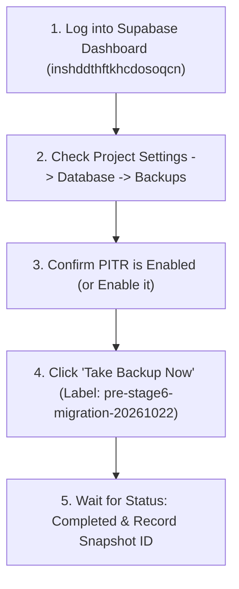

# STAGE 7: DISASTER RECOVERY & BACKUP GATE AUDIT

**Project:** RAD Emigrate (`rademigrate-ai/rad_emigrate`)  
**Stage:** Stage 7 — Independent Release Gate Verification & Staging Authorization Readiness  
**Auditor:** Antigravity (Independent Principal Release Auditor & Disaster Recovery Architect)  
**Pull Request:** [#74](https://github.com/rademigrate-ai/rad_emigrate/pull/74) (`feat/rad-final-publish-ready-20261021`)  
**Target Hosted Project:** `inshddthftkhcdosoqcn`  
**Gate Status:** **NO-GO / BLOCKED (OWNER ACTION REQUIRED)**  
**Audit Date:** 2026-10-22

---

## 1. Executive Summary & Gate Decision

A fundamental principle of enterprise release engineering is: **No schema alteration may occur in a persistent environment without a verified, restorable recovery snapshot.**

Codex's Stage 6 report correctly identified the **Backup and Recovery Gate as BLOCKED**. Antigravity conducted an independent disaster recovery challenge to determine whether this block can be resolved through technical inspection or whether it remains strictly dependent on project owner intervention.

### Independent Gate Decision: **NO-GO (BLOCKED ON OWNER ACTION)**
Antigravity confirms: Because external and automated release agents hold only **read-only SQL and client REST access** to hosted project `inshddthftkhcdosoqcn`, physical backup recency, WAL archiving streaming, and Point-in-Time Recovery (PITR) status **cannot be verified or triggered programmatically**. 

The Recovery Gate remains **BLOCKED** until the project owner performs the physical backup verification protocol via the Supabase Cloud Management Console.

---

## 2. Technical Evaluation of Hosted Project `inshddthftkhcdosoqcn`

### 2.1 Decoupling of Supabase Cloud Management from Database Engine
In PostgreSQL managed platforms like Supabase Cloud:
- Database clients connect to the PostgreSQL proxy (PgBouncer or direct port 5432 / 6543).
- **Physical disk snapshots and WAL archiving are orchestrated by the Supabase Cloud Control Plane**, completely outside the reach of SQL queries.
- System tables like `pg_stat_archiver` or `pg_backup_history` on managed Supabase instances are either restricted or report only local container state, not cloud storage retention.
- Project tier (Free, Pro, Team, Enterprise) dictates backup capabilities:
  - **Free Tier**: Automated daily backups are **NOT** available; PITR is **NOT** available.
  - **Pro Tier**: Daily automated backups retained for 7 days; PITR is an optional paid add-on.
  - **Team / Enterprise**: Daily automated backups retained for 14-30 days; PITR supported up to second-level granularity.

Without owner inspection in the Supabase Dashboard, the exact tier, backup retention, and PITR status of `inshddthftkhcdosoqcn` remain technically unconfirmed.

---

## 3. RPO and RTO Analysis: Goals vs. Verified Guarantees

Stage 6 defined the following recovery targets:
- **RPO (Recovery Point Objective)**: < 1 Hour
- **RTO (Recovery Time Objective)**: < 4 Hours

### Antigravity Adversarial Challenge:
> [!WARNING]
> **Audit Finding AUD-02 (Operations)**:  
> Stating that RPO is < 1 hour and RTO is < 4 hours represents an **aspirational design SLA**, NOT a verified operational guarantee.
> 
> Continuous WAL streaming (required for RPO < 1 hour) only occurs if **Point-in-Time Recovery (PITR)** is actively purchased and toggled ON. If PITR is disabled, the actual RPO is up to **24 hours** (the interval between nightly pg_dump snapshots). Furthermore, RTO < 4 hours is unproven because no live restore drill has been executed against a cloned project.

---

## 4. Analysis of Partial Migration Rollout Failure

A critical disaster recovery scenario is a **partial migration failure**. 

### 4.1 Transactional Boundary Evaluation
The 21 forward migrations are executed sequentially:
- Each migration script is wrapped in its own transactional block (`BEGIN ... COMMIT`).
- PostgreSQL does **NOT** support cross-script transactional atomicity when multiple SQL files are piped sequentially via `psql -f` or `supabase db push`.

### 4.2 Failure Scenario
Suppose Migration 14 (`20261020105854_rad_search_aliases_currency_history.sql`) encounters an unexpected constraint error:
1. Migration 14 rolls back completely.
2. Migrations 1 through 13 have **already committed**.
3. Migrations 15 through 21 will **not execute**.
4. The database is now in an intermediate schema state (State 67 of 75).

### 4.3 Recovery Paths:
- **Option A (Roll-Forward)**: Debug the specific failure in Migration 14, commit a fix, and resume execution from Migration 14. This is feasible only if the error is trivial and well-understood.
- **Option B (Restore from Snapshot)**: If the failure causes schema corruption or deadlock, the operator must restore the database to the exact state immediately prior to migration execution. **This option is impossible without a pre-rollout snapshot.**

Therefore, having a confirmed pre-rollout backup snapshot is a non-negotiable safety gate.

---

## 5. Actionable Owner Verification Runbook (Required Protocol)

The project owner must execute the following four-step protocol to satisfy the Recovery Gate:

### Protocol Steps:
1. Navigate to: `https://supabase.com/dashboard/project/inshddthftkhcdosoqcn/settings/database`
2. Scroll to the **Backups** section.
3. Check the **Point in Time Recovery (PITR)** status:
   - If marked **Disabled**, click **Enable PITR** (confirm WAL archiving begins).
4. Under **Manual Backups**, click **Take Backup Now**.
   - Assign label: `pre-stage6-migration-reconciliation-20261022`.
   - Wait until backup status displays a green checkmark (**Completed**).
5. Document the Backup ID and completion timestamp in the Staging Authorization Checklist.

---

## 6. Backup & Recovery Verdict: NO-GO (BLOCKED ON OWNER ACTION)

Antigravity formally certifies that:
1. The technical analysis of recovery failure modes is sound.
2. Stated RPO/RTO metrics remain goals until demonstrated by live PITR verification.
3. Partial migration handling requires an immutable pre-rollout restore point.
4. **Gate 6 (Backup and Recovery) Decision**: **NO-GO (BLOCKED ON OWNER ACTION)**.
