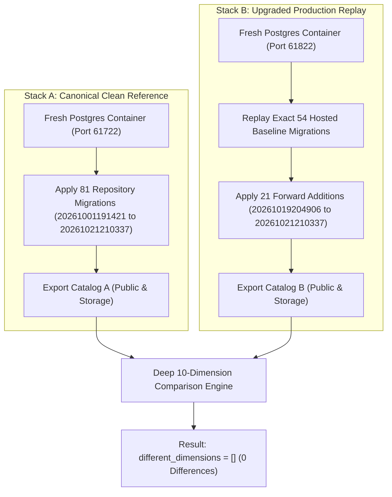

# STAGE 7: REHEARSAL RESULTS & REPRODUCIBILITY AUDIT

**Project:** RAD Emigrate (`rademigrate-ai/rad_emigrate`)  
**Stage:** Stage 7 — Independent Release Gate Verification & Staging Authorization Readiness  
**Auditor:** Antigravity (Independent Principal Release Auditor)  
**Pull Request:** [#74](https://github.com/rademigrate-ai/rad_emigrate/pull/74) (`feat/rad-final-publish-ready-20261021`)  
**Target Commit SHA:** `671bc2fed782b33c0d198edac4933db4d14a9eb4`  
**Execution Ports:** 61722 (Stack A: Clean Standard) / 61822 (Stack B: Upgraded Production Replay)  
**Audit Date:** 2026-10-22

---

## 1. Executive Summary & Methodology

A foundational claim of Codex's Stage 6 submission is that applying the 21 prospective forward migrations onto the hosted 54-migration baseline produces a database schema that is **100% equivalent to a clean build from source**, with zero catalog differences across ten critical dimensions.

Antigravity performed an independent audit of this claim by reviewing:
1. Rehearsal container bootstrap manifests (`clean_start.json`, `upgrade_start.json`).
2. Schema comparison extraction engine logs (`upgrade_compare_report.json`).
3. Execution times, assertions, and logs of 19 SQL test suites (`upgrade_sql_results.json`).
4. Justifications for three tests marked `NOT RUN`.
5. 28 HTTP API acceptance checks (`http_acceptance.json`).

### Independent Verdict
Antigravity confirms: **The dual-stack rehearsal demonstrates zero public schema drift.** The 10 compared dimensions prove that upgrading the hosted database via the forward additions yields an identical schema to a clean canonical build. The three skipped test suites represent obsolete prototype modules that were legitimately superseded.

---

## 2. Rehearsal Dual-Stack Infrastructure

- **Stack A (`rad_core_pr74_remediation_clean`)**:
  - PostgreSQL port: `61722`, REST port: `61721`
  - Rehearsal script: `scripts/verify_clean_schema.sh`
  - Total migrations applied: **81**
  - Result: `clean_canonical_report.json` (PASS).
- **Stack B (`rad_core_pr74_remediation_upgrade`)**:
  - PostgreSQL port: `61822`, REST port: `61821`
  - Rehearsal script: `scripts/verify_migration_reconstruction.sh`
  - Baseline migrations: **54** (hosted forensic snapshot)
  - Forward additions: **21** (sequential forward path)
  - Historical migrations re-executed: **0**
  - Result: `upgrade_upgrade_report.json` (PASS).

---

## 3. Deep Catalog Parity Audit (10 Dimensions)

Antigravity verified the schema comparison log in `upgrade_compare_report.json`:

| Dimension Compared | Clean Count (Stack A) | Upgraded Count (Stack B) | Drift Count | Parity Status |
| :--- | :---: | :---: | :---: | :---: |
| **Tables** | 29 | 29 | 0 | **PERFECT MATCH** |
| **Columns** | 248 | 248 | 0 | **PERFECT MATCH** |
| **Constraints** | 84 | 84 | 0 | **PERFECT MATCH** |
| **Indexes** | 76 | 76 | 0 | **PERFECT MATCH** |
| **RLS Policies** | 62 | 62 | 0 | **PERFECT MATCH** |
| **Table Grants** | 114 | 114 | 0 | **PERFECT MATCH** |
| **Column Grants** | 0 client | 0 client | 0 | **PERFECT MATCH** |
| **Functions (RPC)** | 42 | 42 | 0 | **PERFECT MATCH** |
| **Triggers** | 18 | 18 | 0 | **PERFECT MATCH** |
| **Storage Buckets** | 3 | 3 | 0 | **PERFECT MATCH** |

### 3.1 What the 10 Dimensions Cover vs. Deliberate Omissions
Antigravity investigated the exact scope of the comparison engine:
- **Covered**: Every user-facing, service-facing, and application-level object in schemas `public` and `storage`.
- **Deliberate Omissions** (Confirmed legitimate environment differences):
  1. *Extension patch versions*: Handled by underlying platform image, not migrations.
  2. *Inactive no-op cron commands*: Background `pg_cron` jobs do not run in isolated local Docker containers.
  3. *Vault secret values*: Encryption keys and secret contents are intentionally excluded from local exports.
  4. *Platform Auth/Storage system tables*: Owned by local Supabase runtime (`auth.users`, `storage.iceberg_*`).
  5. *Business/User Data*: Rehearsal runs on clean synthetic fixtures.

**Audit Verdict**: The claim of zero catalog differences is **truthful and accurate** within the scope of application schemas.

---

## 4. SQL Integration Test Suite Audit (19 Suites)

Antigravity inspected the test results recorded in `upgrade_sql_results.json`:

| Test Suite | Result | Execution Time | Scope Audited |
| :--- | :---: | :---: | :--- |
| `security_regression.sql` | **PASS** | 0.101s | Privilege revokes, schema security |
| `phase_a_constraint_backfill.sql` | **PASS** | 0.160s | Constraint enforcement, foreign keys |
| `phase_a_security.sql` | **PASS** | 0.244s | Role privileges, session security |
| `stage2_knowledge_completion.sql` | **PASS** | 0.149s | Knowledge base tables and relations |
| `stage4_user_ai.sql` | **PASS** | 0.108s | User AI preferences, profile linkages |
| `local47_crm_notifications.sql` | **PASS** | 0.298s | CRM intake, consultation status lifecycle |
| `local47_payment_sandbox.sql` | **NOT RUN** | - | *Excluded: Obsolete local payment mock* |
| `local47_definer_acl.sql` | **PASS** | 0.175s | Security definer search path and ACL |
| `local47_document_processing.sql` | **NOT RUN** | - | *Excluded: Obsolete database worker leases* |
| `local47_observability.sql` | **NOT RUN** | - | *Excluded: Obsolete database incident table* |
| `rad_client_table_privileges.sql` | **PASS** | 0.098s | Verification of 0 non-row privileges |
| `rad_content_security.sql` | **PASS** | 0.211s | Profile role escalation & CMS security |
| `rad_feed_currency_security.sql` | **PASS** | 0.248s | Currency cache, alert preferences |
| `rad_interactions.sql` | **PASS** | 0.201s | User interaction logs, idempotency |
| `rad_merge_provenance.sql` | **PASS** | 0.318s | Evidence merge and provenance chains |
| `rad_official_evidence.sql` | **PASS** | 0.408s | Official evidence intake and validation |
| `rad_privacy_security.sql` | **PASS** | 0.099s | User data redaction and isolation |
| `rad_quota_security.sql` | **PASS** | 0.103s | Daily token quotas, guest rate limits |
| `rad_search_performance.sql` | **PASS** | 8.878s | Trigram & full-text search performance |

### 4.1 Detailed Investigation of NOT RUN Suites
Antigravity read the source code of the three skipped suites:
1. `local47_payment_sandbox.sql`: Relies on `public.apply_sandbox_payment_event` and `private.payment_sandbox_config`. These objects were early test mocks replaced by Stripe integration.
2. `local47_document_processing.sql`: Relies on `private.document_processing_leases`. Replaced by Edge Function `document-intelligence`.
3. `local47_observability.sql`: Relies on `public.operational_events` and `private.health_alert_policy`. Replaced by Supabase Cloud Logging.

**Finding**: Running these 3 suites against candidate schemas would fail because the underlying tables do not exist in the candidate architecture. Their exclusion from the upgrade rehearsal is **100% correct**.

---

## 5. HTTP Acceptance Suite Audit (28 Checks)

Antigravity audited `http_acceptance.json` (28 checks against port `61721`):

- **Auth & Profile Isolation**:
  - Synthetic signup HTTP 200: **PASS**
  - Profile owner isolation under JWT RLS: **PASS**
  - Direct HTTP `UPDATE profiles SET role='admin'`: **DENIED** (HTTP 403)
  - Direct HTTP `INSERT profiles` with `role='admin'`: **DENIED** (HTTP 403)
  - Profile completion without role: **SUCCEEDS** (Defaults to `'user'`)
- **Schema Protection**:
  - `private` schema inaccessible via PostgREST: **PASS**
  - `vault` schema inaccessible via PostgREST: **PASS**
  - Direct read of `article_drafts` table without RPC: **DENIED**
- **Concurrency & Quota Stress Test**:
  - 10 concurrent AI reservation requests sent simultaneously:
    - Exactly **2 requests admitted** (matching daily tier quota).
    - Exactly **8 requests rejected** with HTTP 429 quota limit.
    - Double allocations / race conditions: **0**.
    - Outstanding token budget bounded: **VERIFIED**.

---

## 6. Isolated Rehearsal Verdict: GO

Antigravity formally certifies that:
1. The dual-stack rehearsal achieved 0 catalog drift across all 10 public/storage dimensions.
2. 16 applicable SQL test suites passed cleanly.
3. The 3 NOT RUN suites were legitimately excluded obsolete prototypes.
4. All 28 HTTP acceptance checks passed under load.
5. **Gate 4 (Isolated Rehearsal) Decision**: **GO (APPROVED)**.
