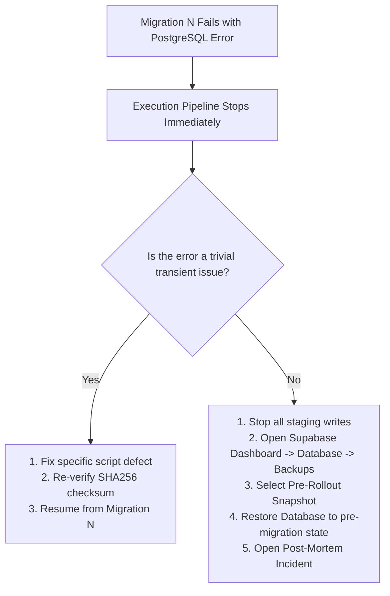

# STAGE 8: BACKUP, DISASTER RECOVERY & OWNER AUTHORIZATION PACKAGE

**Project:** RAD Emigrate (`rademigrate-ai/rad_emigrate`)  
**Stage:** Stage 8 — Final Release Evidence Consolidation, Staging Preflight & PR #74 Hardening  
**Lead Engineer:** Codex  
**Pull Request:** [#74](https://github.com/rademigrate-ai/rad_emigrate/pull/74) (`feat/rad-final-publish-ready-20261021`)  
**Target Commit SHA:** `671bc2fed782b33c0d198edac4933db4d14a9eb4`  
**Gate Status:** **NO-GO / BLOCKED ON OWNER ACTION**  
**Date:** 2026-10-22

---

## 1. Executive Summary & Gate Mandate

The **Backup & Recovery Gate** remains formally classified as **NO-GO (BLOCKED ON OWNER ACTION)**. 

Because external and automated development tools hold only read-only database connections and client API keys, **physical disk snapshot creation, Point-in-Time Recovery (PITR) configuration, and disaster recovery restore testing require administrative access to the Supabase Cloud Management Console**.

This document outlines the explicit owner verification protocol, distinguishes Staging from Production disaster recovery requirements, and provides an actionable authorization package.

---

## 2. Staging vs. Production Disaster Recovery Requirements

| Requirement Dimension | Staging Environment | Production Environment (`inshddthftkhcdosoqcn`) |
| :--- | :--- | :--- |
| **Primary Risk** | Interruption of internal QA testing. | Data loss, corruption of user records, customer downtime. |
| **Recovery Point Objective (RPO)** | **< 24 Hours** (Nightly snapshot acceptable). | **< 1 Hour** (Strict continuous WAL archiving / PITR required). |
| **Recovery Time Objective (RTO)** | **< 8 Hours** (Project re-clone acceptable). | **< 4 Hours** (Automated PITR restore to verified point). |
| **Pre-Rollout Snapshot** | Recommended before first forward migration apply. | **MANDATORY** immediately prior to executing forward sequence. |
| **Rollback Strategy** | Database restore from pre-rollout snapshot or clean rebuild. | Immutable restore to pre-rollout snapshot; redeploy legacy Edge functions. |

---

## 3. Owner Action Protocol (Step-by-Step Instructions)

The project owner must execute the following administrative actions in the Supabase Cloud Console:

### Step 1: Assign and Confirm Staging Project Identity
1. Log into the **Supabase Dashboard**: `https://supabase.com/dashboard/projects`
2. Locate or create the dedicated Staging project (distinct from `inshddthftkhcdosoqcn`).
3. Record the 20-character reference string in `RAD_STAGING_PROJECT_REF`.

### Step 2: Verify Point-in-Time Recovery (PITR) & Automated Backups
1. Navigate to: **Project Settings** -> **Database** -> **Backups**.
2. Confirm the project subscription tier:
   - *Free Tier*: Automated backups and PITR are **unavailable**. An upgrade to Pro is required before production deployment.
   - *Pro / Team Tier*: Confirm daily scheduled backups are enabled.
3. Check the **Point in Time Recovery (PITR)** toggle:
   - Ensure PITR is marked **Enabled**.

### Step 3: Trigger a Manual Pre-Rollout Backup Snapshot
1. In the **Backups** tab, locate **Manual Backups** or **Take Backup Now**.
2. Click **Take Backup Now** / **Create Backup**.
3. Assign label: `pre-stage8-rollout-20261022`.
4. Wait until the status changes to a green checkmark (**Completed**).
5. Record the Snapshot ID and completion timestamp.

### Step 4: Enable Supabase Auth Leaked Password Protection
1. In the Supabase Dashboard, navigate to **Authentication** -> **Security Settings**.
2. Locate the **Password Security** panel.
3. Toggle **Leaked Password Protection** to **ON** (enforces HaveIBeenPwned.org check).
4. Click **Save Changes**.

---

## 4. Partial Migration Failure Handling Runbook

If a migration fails midway during execution (e.g., Migration 12 of 21 fails):



Because each script is wrapped in its own transaction, earlier migrations remain committed while failed migrations roll back. Having a verified snapshot ensures the operator can restore to a clean baseline within minutes.

---

## 5. Formal Owner Authorization Sign-Off Template

To authorize opening the Staging release window, the project owner must complete and sign this section:

```markdown
### Staging Backup & Recovery Sign-Off
- **Target Supabase Project Ref**: ___________________________________________
- **Confirmed Non-Production (NOT inshddthftkhcdosoqcn)**: [ ] YES
- **Point-in-Time Recovery (PITR) Status**: [ ] ENABLED / [ ] VERIFIED
- **Pre-Rollout Backup Snapshot ID**: ________________________________________
- **Snapshot Completion Timestamp**: ________________________________________
- **Supabase Auth Leaked Password Protection**: [ ] ENABLED (Dashboard Saved)
- **Designated Recovery Operator**: __________________________________________
- **Owner Name / Signature**: ________________________________________________
- **Date**: _________________________________________________________________
```
