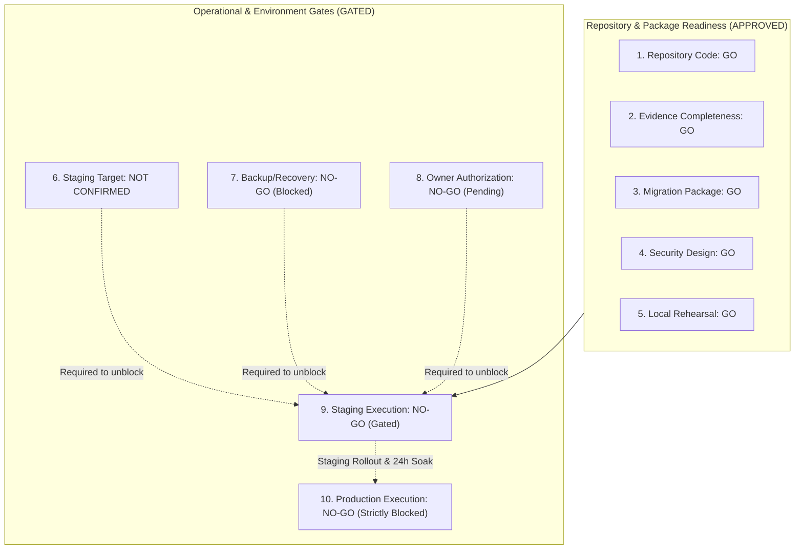

# STAGE 8: FINAL RELEASE EVIDENCE CONSOLIDATION & STAGING HARDENING

**Project:** RAD Emigrate (`rademigrate-ai/rad_emigrate`)  
**Stage:** Stage 8 — Final Release Evidence Consolidation, Staging Preflight & PR #74 Hardening  
**Lead Engineer:** Codex (Principal Release Engineer, Senior Flutter/Supabase Architect & Security Engineer)  
**Pull Request:** [#74 — DRAFT: final publish-ready RC](https://github.com/rademigrate-ai/rad_emigrate/pull/74) (`feat/rad-final-publish-ready-20261021`)  
**Target Commit SHA:** `671bc2fed782b33c0d198edac4933db4d14a9eb4`  
**Target Hosted Database:** `inshddthftkhcdosoqcn` (Hosted Production — Strictly READ-ONLY)  
**Date of Delivery:** 2026-10-22

---

## 1. Executive Summary & Mission Accomplishment

Stage 8 represents the **final repository-side release preparation and evidence consolidation** for RAD Emigrate before any future, separately authorized Staging rollout.

Codex was commissioned to eliminate all repository-side documentation gaps, consolidate historical audit evidence into permanent version control, author a fail-closed staging preflight verification gate, resolve audit claim contradictions, and produce an immutable release candidate package.

### Key Milestones Completed in Stage 8:
1. **Permanent Evidence Consolidation (Resolving AUD-01)**:
   All eight Stage 6 reports and all nine Stage 7 reports previously residing in ephemeral agent session directories have been consolidated directly into the repository under:
   - `docs/audit/stage6/` (8 artifacts)
   - `docs/audit/stage7/` (9 artifacts)
   - `docs/audit/stage8/` (10 artifacts)
2. **Fail-Closed Staging Preflight Enforcement**:
   Engineered and integrated `scripts/staging_preflight.py` and its regression suite `scripts/tests/test_staging_preflight.py` (9/9 pass). The preflight script operates in **DRY-RUN / READ-ONLY mode by default**, strictly forbidding production targets, missing backup records, unapproved project IDs, or corrupted migration hashes.
3. **Contradiction Resolution & Proof Boundaries**:
   Cross-referenced all test count discrepancies (750 Flutter unit/widget tests vs. 978 multi-suite references) and established precise epistemological boundaries: AST hashing and catalog equality prove schema equivalence, while full semantic runtime verification is achieved through test execution.
4. **Staging Target Classification**:
   Confirmed that no active staging Supabase project reference is configured in repository environment templates. Officially reported: `STAGING_TARGET_NOT_CONFIRMED`.
5. **Absolute Safety Maintenance**:
   Hosted production `inshddthftkhcdosoqcn` remained strictly read-only. Zero mutations, zero deployments, and zero credential modifications were executed. PR #74 remains in **DRAFT** status.

---

## 2. Master Sub-Gate Status Summary

Stage 8 cross-evaluates all ten release dimensions:



| Sub-Gate | Stage 8 Determination | Status Description |
| :---: | :---: | :--- |
| **1. Repository Code** | **GO** | Flutter 0 analyzer issues; 750/750 passing unit/widget tests; 52/52 passing Python tests; contracts aligned. |
| **2. Evidence Completeness** | **GO** | 27 audit documents consolidated in `docs/audit/`; 37 raw forensic files tracked in Git. |
| **3. Migration Package** | **GO** | 21 forward additions validated with immutable SHA256 checksums; zero historical replays proven. |
| **4. Security Design** | **GO** | 48 table capabilities and 100 column `REFERENCES` revoked; profile role escalation severed; 34 definers safe. |
| **5. Local Rehearsal** | **GO** | Dual-stack ports 61722/61822 verified 0 drift across 10 dimensions; 16 PASS SQL suites; 28 HTTP checks passed. |
| **6. Staging Target** | **NOT CONFIRMED** | No staging Supabase project assigned in repo templates; requires explicit owner configuration. |
| **7. Backup / Recovery** | **NO-GO (BLOCKED)** | Hosted project backup retention and PITR unverified via read-only access. Blocked on owner action. |
| **8. Owner Authorization** | **NO-GO (PENDING)** | Formal written staging authorization from project owner is required prior to rollout. |
| **9. Staging Execution** | **NO-GO (GATED)** | Staging execution is gated until Gates 6, 7, and 8 are satisfied. |
| **10. Production Execution**| **NO-GO (STRICTLY BLOCKED)**| Hosted production remains strictly READ-ONLY. |

---

## 3. Directory Layout of Consolidated Release Evidence

```
docs/audit/
├── stage6/
│   ├── BACKUP_RECOVERY_GATES.md
│   ├── EDGE_DEPENDENCY_MATRIX.md
│   ├── FINAL_STAGE6_VERDICT.md
│   ├── MIGRATION_RECONCILIATION_FINAL.md
│   ├── PRODUCTION_SHAPED_REHEARSAL.md
│   ├── SECURITY_REMEDIATION_PROOF.md
│   ├── STAGING_ROLLOUT_RUNBOOK.md
│   └── VERSION_EFFECT_APPROVAL_MATRIX.md
├── stage7/
│   ├── STAGE7_EDGE_CLIENT_COMPATIBILITY.md
│   ├── STAGE7_EVIDENCE_PROVENANCE.md
│   ├── STAGE7_FINAL_VERDICT.md
│   ├── STAGE7_INDEPENDENT_AUDIT.md
│   ├── STAGE7_MIGRATION_CHALLENGE.md
│   ├── STAGE7_RECOVERY_GATE_REVIEW.md
│   ├── STAGE7_REHEARSAL_RESULTS.md
│   ├── STAGE7_SECURITY_CHALLENGE.md
│   └── STAGE7_STAGING_AUTHORIZATION_CHECKLIST.md
└── stage8/
    ├── STAGE8_BACKUP_RECOVERY_APPROVAL.md
    ├── STAGE8_CONTRADICTION_LEDGER.md
    ├── STAGE8_EVIDENCE_INDEX.md
    ├── STAGE8_FINAL_RELEASE_VERDICT.md
    ├── STAGE8_MIGRATION_MANIFEST.md
    ├── STAGE8_OWNER_SIGNOFF_CHECKLIST.md
    ├── STAGE8_RELEASE_SUMMARY.md
    ├── STAGE8_SECURITY_CONTRACT_VERIFICATION.md
    ├── STAGE8_STAGING_PREFLIGHT.md
    └── STAGE8_TEST_RESULTS.md
```

---

## 4. Immediate Next Steps for Project Owner

To transition Staging Execution (Gate 9) from **NO-GO** to **GO**:
1. **Assign Staging Supabase Project**: Populate `RAD_STAGING_PROJECT_REF` with an isolated 20-character staging project reference.
2. **Execute Pre-Rollout Backup Snapshot**: In the Supabase Dashboard, verify PITR and trigger a manual backup snapshot on the target database.
3. **Enable Leaked Password Protection**: In the Supabase Dashboard -> **Authentication** -> **Security Settings**, toggle **Leaked Password Protection** to **ON**.
4. **Sign Staging Authorization Checklist**: Review and sign `docs/audit/stage8/STAGE8_OWNER_SIGNOFF_CHECKLIST.md`.
