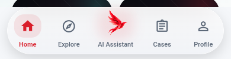
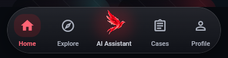
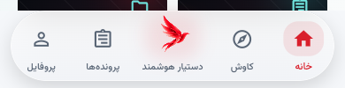
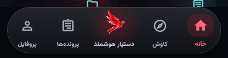

# RAD capsule navigation verification

The approved mobile navigation is Home, Explore, AI Assistant, Cases, Profile.
Persian mirrors this reading order. Every destination keeps its localized label
below its icon, including the assistant. Inactive icons are outlines; the active
destination uses its filled icon, RAD red, and a restrained selection surface.

The capsule is 80 logical pixels high at normal text size, plus an 8 px bottom
gap and the platform safe area. This grows from the 72 px starting layout to
accommodate the 48 px bird and the aligned labels. Large system text can wrap
inside a taller label region. The bird center is 6 px above the other icon
centers. These dimensions are asserted in both locales and both themes.

## Artwork provenance

The existing `rad_flying_bird_1024.png` is byte-identical to both owner-uploaded
files recorded in the latest agent report:

- `media_1792144516754_c60f16a9.png`
- `media_1792151475885_0b67479c.png`

SHA-256: `5922e4874cdcaaddfd4ec90e133d764733a7dfc7039b134ca66b8a59c0c22a06`.

No artwork was generated or replaced. The assistant now uses the matching
`rad_flying_bird_512.png` derivative instead of the previous, different
`rad_phoenix_final_512.png`. Articulation hinges the source wing pixels around
the shoulder and keeps the body stable. The loader's segmentation was corrected
to the same side-profile anatomy. The navigation bird has no lens or frame,
retains a soft idle glow, and settles to the intact source image for Reduce
Motion. A new assistant reply updates the persistent dot and triggers a brief
wing response; opening the assistant clears the dot.

## Behavior

- `StatefulShellRoute.indexedStack` keeps the visited tab navigators and page
  state alive when switching tabs. A regression test types into one tab,
  switches to another, and verifies the original value on return.
- The bar stays outside the scrollable page body and hides when keyboard
  insets are nonzero. SafeArea keeps the capsule above the home gesture area.
- The bird opens the existing full-page `/ai-assistant` destination. The
  existing long-press, keyboard, and accessible More actions remain available.
- All destinations provide subtle scale feedback and selection haptics.
  Reduce Motion suppresses the animation while retaining selection and dot cues.

## Visual comparison

These are Chrome captures of the actual Flutter AppShell component around the
existing synthetic dashboard fixture, at 390 × 844. They are not captures of
customer data or evidence of physical-device execution. The browser recorded
zero page/console errors in all four captures; see `capture-manifest.json`.

| Locale | Light | Dark |
| --- | --- | --- |
| English / LTR |  |  |
| Persian / RTL |  |  |

Full viewport images are the corresponding `mobile-*.png` files. The previous
PR navigation is visible in [the preserved baseline capture](../after-mobile-fa-dark-shell.png).
Compared with it, the new bar is a continuous capsule, the center mark uses the
verified owner artwork at the requested size, and Explore replaces the Visa
tab label without changing its destination route.

To reproduce, build `lib/visual_qa_main.dart`, serve `build/web` on a free local
port, then run `tools/capture_navigation_qa.cjs` with Playwright available.
`RAD_QA_BASE_URL` overrides the default `http://127.0.0.1:8795/`.

## Verification and boundaries

- Dart format: 236 files, zero remaining changes.
- Flutter analyze: zero issues.
- Complete Flutter suite: 341 tests passed.
- Navigation layout tests: 320 px width, 200% text, baseline alignment,
  keyboard hiding, semantics, and simulated 34 px bottom safe area pass.
- Web release entrypoint and visual-QA entrypoint compile.
- Android debug APK compiles. Existing SDK/Kotlin plugin warnings remain.
- Physical Android and native iOS execution were not performed. Insets are
  covered by widget geometry tests; an APK build does not establish device QA.

Changes continue draft PR #54 from verified starting head
`3e850f1692a81d81861877e05e41e4eea11ff605`. The final commit SHA and CI result
are reported with the PR handoff. No merge, deployment, production Supabase
change, migration, or skill installation was performed.
